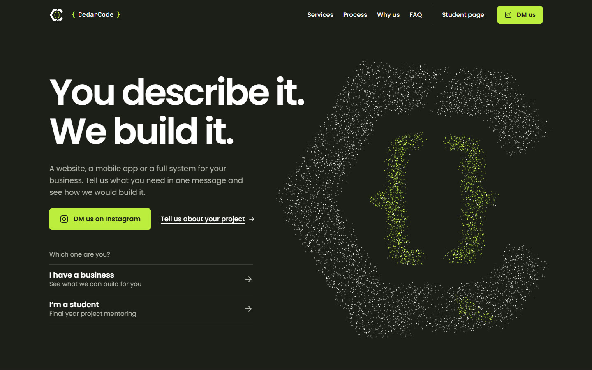
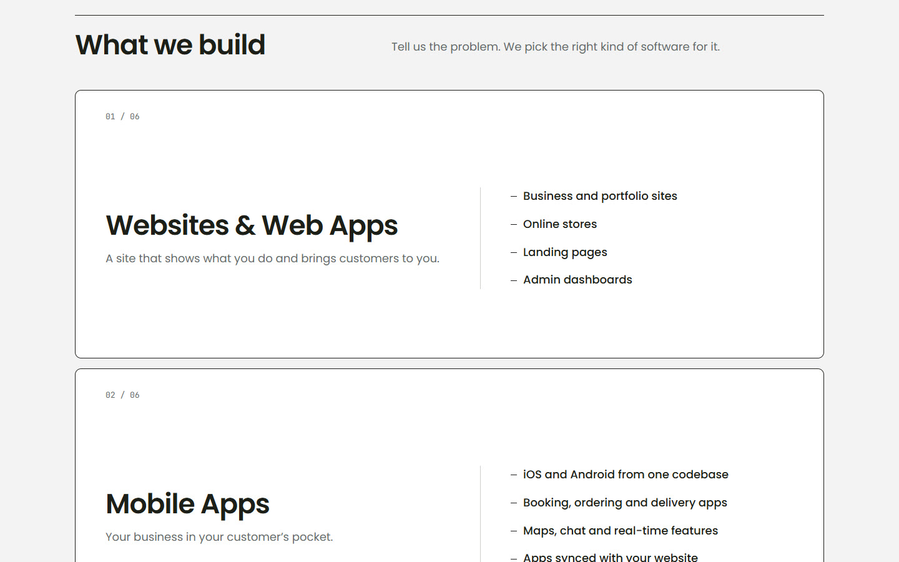
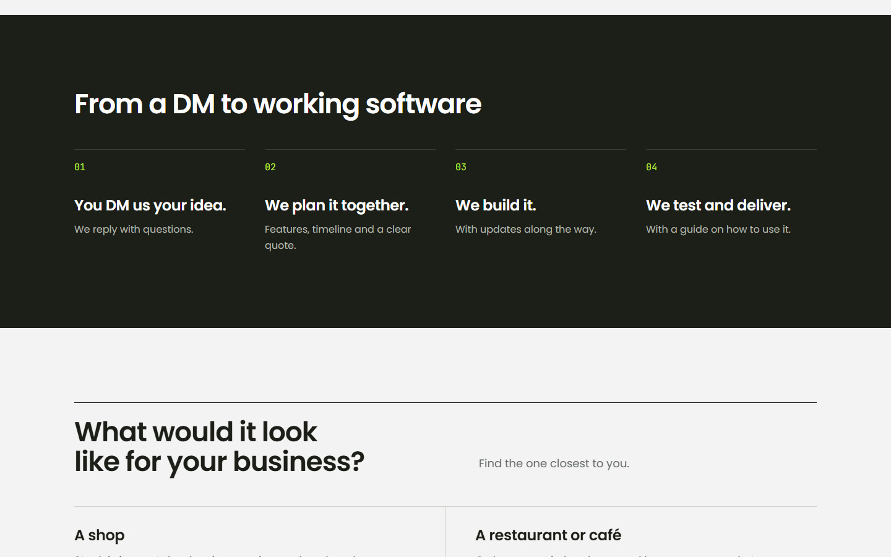
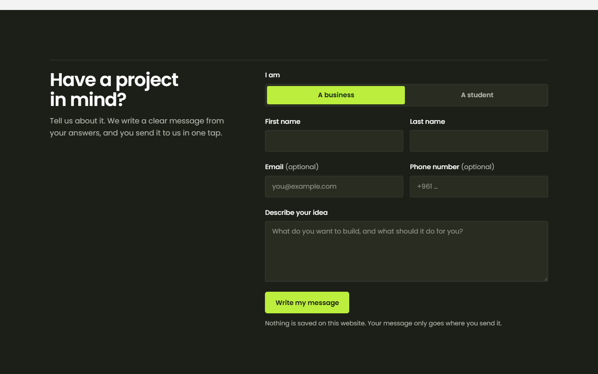
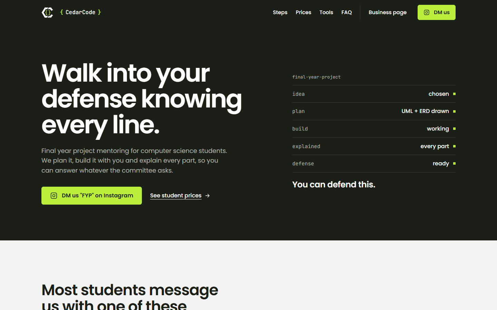
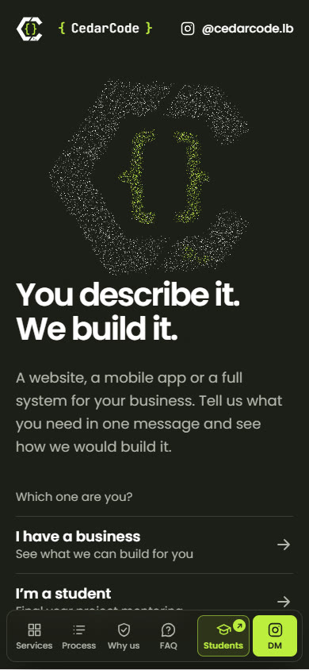
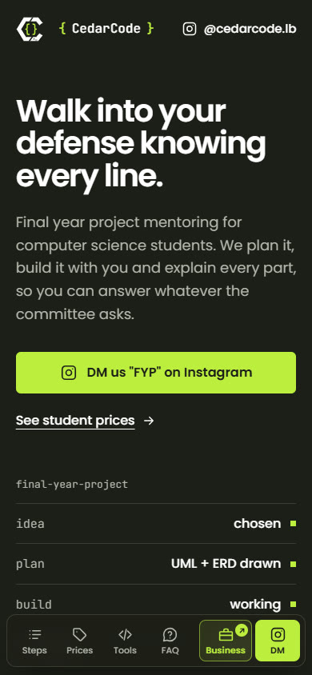

# CedarCode · Studio Website

**The website for CedarCode, a web and app studio in Lebanon, built to turn Instagram visitors into conversations.**

## The problem

Most people find the studio through Instagram, on a phone, inside Instagram's own browser. Business owners and students need to understand quickly what the studio builds, and not everyone knows how to describe the project they want.

## The solution

A fast two-page website, one page for businesses and one for computer-science students, that explains the services in plain language and includes a short form that turns a visitor's answers into a clear project message, ready to send by Instagram DM or email.

## Key features

- **Animated 3D logo** made of particles that morph between the CedarCode mark, `</>` and `{ }`.
- **Business page:** services, the four-step process, examples by type of business, and FAQ.
- **Student page:** final-year project mentoring, steps, prices and FAQ.
- **Project form that writes the message for you**, then opens Instagram DM or email with it. Nothing is stored on the site.
- **Built for phones first:** a floating bottom menu on phones and tablets, and no sideways scrolling even at 360 px.
- **Private and secure:** no cookies, no trackers, self-hosted fonts and strict security headers.

## Screenshots

| Services | Process |
| --- | --- |
|  |  |

| Project form | Student page |
| --- | --- |
|  |  |

  
  &nbsp;&nbsp;
  

## Tech stack

| | |
| --- | --- |
| **Languages** | TypeScript, HTML, CSS |
| **Framework** | Astro (static site) |
| **Graphics** | WebGL |
| **Testing** | Vitest |
| **Hosting** | Vercel, custom domain |

---

> **Source code is private.** For hiring or client review, code access is available on request: DM [@cedarcode.lb](https://instagram.com/cedarcode.lb) or visit [cedarcodesite.com](https://cedarcodesite.com).

© 2026 CedarCode. All rights reserved.
